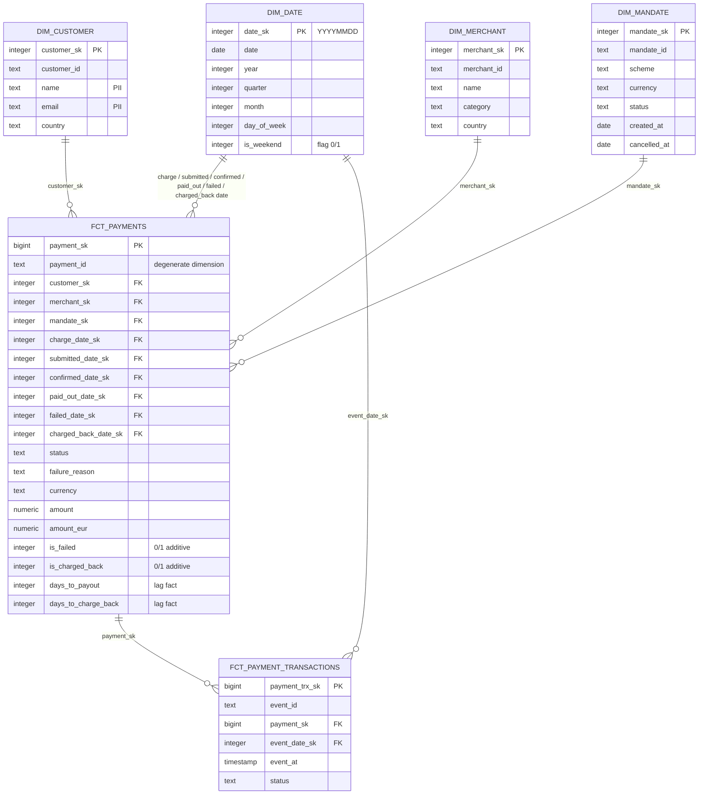

Business process: payment handling

Fact tables:
    fct_payments: “One row per payment, updated as the payment reaches each milestone.”
    fct_payment_transactions: “One row per payment status change.”

    !! In fct_payments the row is updated when a milestone arrives: paid_out_date_sk is filled two days later, is_charged_back becomes 1 weeks later. fct_payment_transactions is append-only: every change is a new row, never an update !!

## Fact tables
        fct_payments(payment_id_sk bigint  -- surrogate key for payment
                    ,payment_id text  --payment_id from payements
                    ,charge_date_sk integer   -- FK to dim_date
                    ,customer_sk  integer     -- FK to dim_customer
                    ,merchant_sk  integer     -- FK to dim_merchant
                    ,mandate_sk   integer     -- FK to mandate
                    ,submitted_date_sk    integer   -- FK to dim_date
                    ,confirmed_date_sk    integer   -- FK to dim_date
                    ,paid_out_date_sk     integer   -- FK to dim_date
                    ,failed_date_sk       integer   -- FK to dim_date
                    ,charged_back_date_sk integer   -- FK to dim_date
                    ,amount         numeric(12, 2)  -- amount (measure)
                    ,status         text   -- status of the payment
                    ,failure_reason text   -- failure reason
                    ,is_failed   integer   -- additive: 0- false 1- true
                    ,is_charged_back      integer   -- additive: 0- false 1- true
                    ,days_to_payout       integer     -- additive: paid_out_date − submitted_date
                    ,days_to_charge_back  integer  -- days till money charged back  
                    ,currency text                 -- Currency
                    ,amount_eur    numeric(12, 2) -- calculated amount in eur by currency  
                    )

        fct_payment_transactions (paym_trx_sk bigint --rurrogate key for payment_events/transacions    
                                 ,event_id text -- id from payemnt_events
                                 ,payment_id_sk  bigint --FK to payments
                                 ,event_at_sk  integer    --FK to dim_date
                                 ,status varchar   -- Degenerate Dimension status
                                 ,customer_sk  integer     -- FK to dim_customer
                                 ,merchant_sk  integer     -- FK to dim_merchant
                                 ,mandate_sk   integer     -- FK to mandate
                                  
                                );

## Dimensions
    dim_date (date_sk integer     -- surrogate key / format YYYYMMDD
             ,calendar_date  DATE  -- real
             ,month  integer      -- month of the year
             ,year   integer      -- year
             ,quarter integer     -- quarter of the year
             ,day_in_week integer -- day ina week
             ,is_weekend_day   integer   -- flag: 0- false 1- true
             ,month_name varchar   --name of the month
             ,year_month varchar   -- year and month in format YYYY-MM             
             );
    
    dim_customer (customer_sk integer       -- surrogate key 1,2,3...
                 ,customer_id text  -- id from customers
                 ,name        text  -- name
                 ,email       text  -- email   
                 ,country     text  -- country
                 );
              
    dim_merchant(merchant_sk  integer        --surrogate key 1,2,3
                ,merchant_id text   -- id from merchans
                 ,name        text  -- name
                 ,category    text  -- category   
                 ,country     text  -- country
                );
    
    
    dim_mandate(mandate_sk integer  --surrogate
               ,mandate_id text --original mandate id
               ,scheme  text
               ,currency text
               ,status  text
               ,created_at date
               ,cancelled_at date
               );

## Business questions
    1 Failure rate by merchant category and month
        SUM(is_failed)::numeric / COUNT(*) GROUP BY dim_merchant.category, dim_date.year, dim_date.month

    2 Total collected in EUR by scheme (SEPA vs Bacs) per quarter
        sum(fct_payments.amount_eur) GROUP BY dim_mandate.scheme, dim_date.year,dim_date.quarter

    3 Average number of days from submission to payout, by scheme
        avg (fct_payments.days_to_payout) GROUP BY dim_mandate.scheme

    4 Top failure reasons for customers in Germany
        where dim_customer.country = 'DE' group by fct_payments.failure_reason ORDER BY COUNT(*) DESC

    5 How many payments were charged back, and how long after payout?
        fct_payments.days_to_charge_back where fct_payments.is_charged_back

## Diagram

